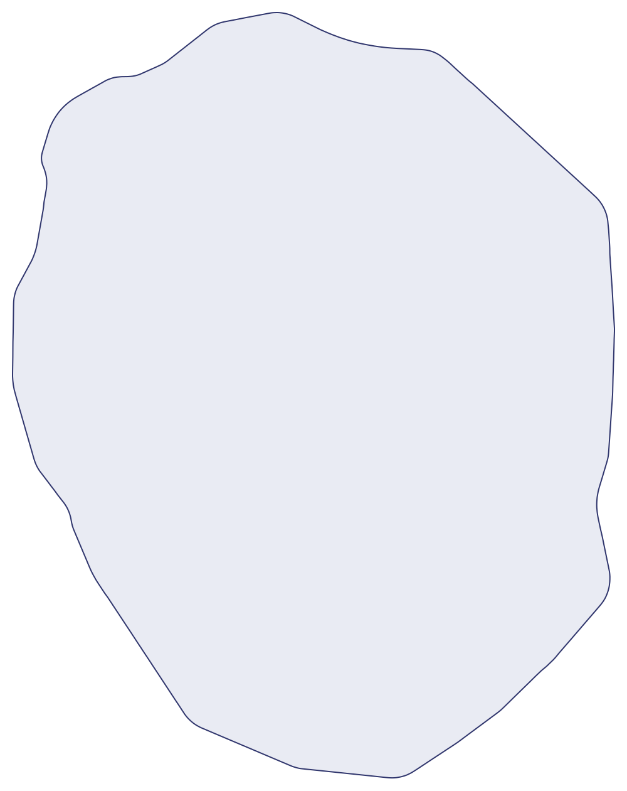
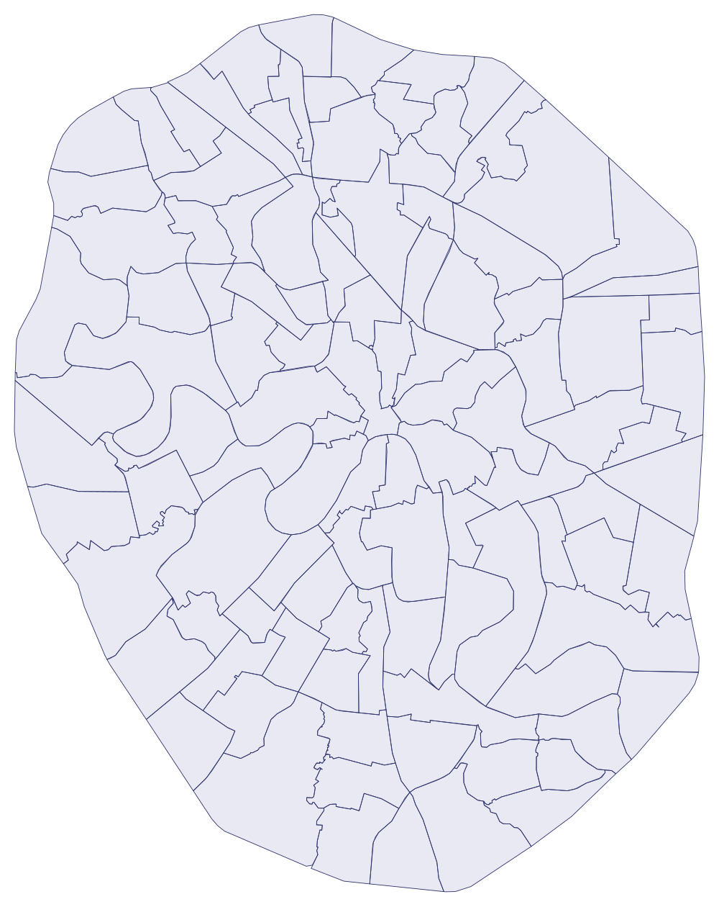

# Moscow Geo

GeoJSON datasets and SVG maps of Moscow districts and the MKAD boundary, with optional
Python tools for filtering districts and exporting vector images.

Наборы GeoJSON и SVG-карты районов Москвы и границы МКАД с Python-скриптами
для обрезки районов и экспорта векторных изображений.

## Описание

В репозитории хранятся готовые GeoJSON и SVG, которые можно использовать
без запуска генераторов. Исходные GeoJSON не изменяются при экспорте SVG.





В каталоге `geojson/` находятся полный и облегченный контуры МКАД,
исходные районы Москвы и готовая выборка районов внутри МКАД.
В каталоге `svg/` лежат соответствующие векторные изображения.
В каталоге `scripts/` находятся утилиты для самостоятельной обработки данных.

## Структура проекта

```text
.
|-- LICENSE
|-- README.md
|-- geojson/
|   |-- districts-in-mkad.geojson
|   |-- low-resolution-mkad.geojson
|   |-- mkad.geojson
|   `-- moscow-districts.geojson
|-- scripts/
|   |-- geojson_to_svg.py
|   `-- mkad_district_filter.py
`-- svg/
    |-- districts-in-mkad.svg
    |-- low-resolution-mkad.svg
    |-- mkad.svg
    `-- moscow-districts.svg
```

Исходными данными служат `moscow-districts.geojson` и `mkad.geojson`.
`low-resolution-mkad.geojson` - сохраненный облегченный контур МКАД.
`districts-in-mkad.geojson` - ранее рассчитанная выборка из 107 районов
с обрезкой по МКАД. Эти файлы сохранены из первоначального архива без изменений.

`moscow-districts.geojson` содержит 119 полигональных объектов районов
и 119 точечных объектов. В SVG отображаются только полигоны.

## Требования

Для работы Python-скриптов нужны Python 3, Shapely и PyProj.
На Arch Linux:

```sh
sudo pacman -S python python-shapely python-pyproj
```

Готовые файлы GeoJSON и SVG можно использовать без этих зависимостей.

## Генерация SVG

Запускать из корня репозитория:

```sh
python3 scripts/geojson_to_svg.py \
    geojson/mkad.geojson svg/mkad.svg \
    --bounds geojson/mkad.geojson --stroke-width 2 --fill-opacity 0.15

python3 scripts/geojson_to_svg.py \
    geojson/districts-in-mkad.geojson svg/districts-in-mkad.svg \
    --bounds geojson/mkad.geojson --stroke-width 0.9 --fill-opacity 0.16

python3 scripts/geojson_to_svg.py \
    geojson/moscow-districts.geojson svg/moscow-districts.svg

python3 scripts/geojson_to_svg.py \
    geojson/low-resolution-mkad.geojson svg/low-resolution-mkad.svg \
    --bounds geojson/mkad.geojson
```

У всех трех SVG, связанных с МКАД, общая область отображения
благодаря `--bounds geojson/mkad.geojson`.
Полная карта районов Москвы использует собственную область отображения.

Размер изображения задается `--width`, отступы - `--padding`,
толщина контура - `--stroke-width`, прозрачность заливки - `--fill-opacity`.
Дополнительное упрощение только SVG включается аргументом
`--simplify-m N` с допуском в метрах. По умолчанию `--simplify-m 0`,
то есть геометрия не упрощается дополнительно.

Генератор SVG читает GeoJSON и не перезаписывает его.

## Пересоздание выборки районов внутри МКАД

Исходный `mkad_district_filter.py` перенесен в `scripts/` без изменения кода
и набора аргументов. Чтобы намеренно пересоздать производный GeoJSON:

```sh
python3 scripts/mkad_district_filter.py \
    geojson/moscow-districts.geojson \
    geojson/mkad.geojson \
    geojson/districts-in-mkad.geojson \
    --simplify-m 60
```

Параметр `--simplify-m N` задает упрощение в метрах, `0` отключает его.
Также доступны `--no-clip`, `--keep-properties`, `--min-ratio N`
и `--buffer-m N`. Все значения можно проверить через `--help`.

Эта команда перезаписывает `geojson/districts-in-mkad.geojson`.
Она не нужна для обычной генерации SVG. Поскольку обработка использует
операции с плавающей точкой, повторный экспорт может отличаться побайтово
от сохраненного набора даже при визуально одинаковой геометрии.

Отдельного исходного генератора `low-resolution-mkad.geojson` не было.
Готовый файл сохраняется без изменений.

## Проверка

```sh
python3 scripts/mkad_district_filter.py --help
python3 scripts/geojson_to_svg.py --help
jq -e '.type == "FeatureCollection"' geojson/districts-in-mkad.geojson
```

## Лицензия

Проект распространяется под лицензией GNU Affero General Public License v3.0.
Подробности см. в файле [LICENSE](LICENSE).
